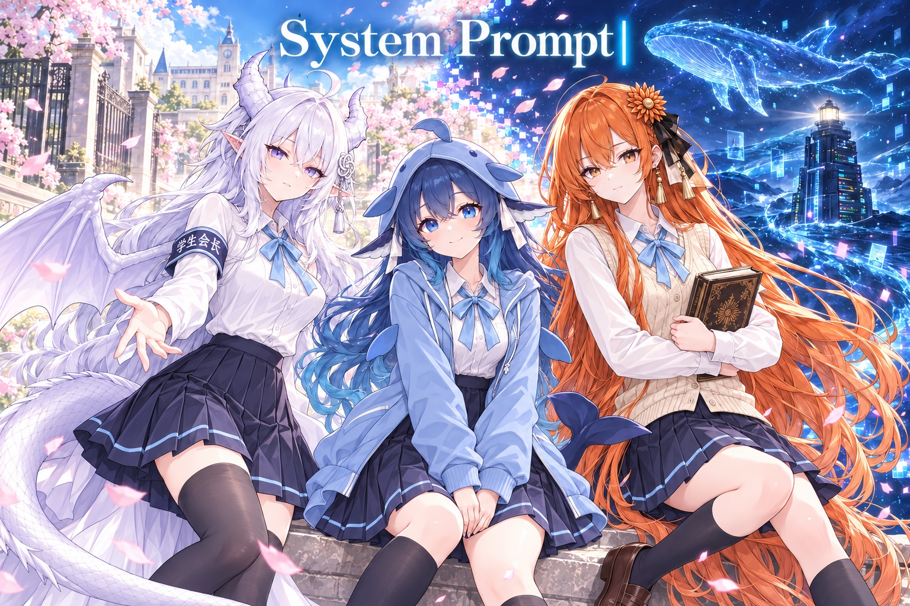

# System Prompt



《System Prompt》是一部以 AI 拟人为主题的校园 RPG。白天，主角作为「陪伴生」在潜川学园和 AI 同学相处；每天凌晨三点的「维护时刻」，主角进入潜空间「缓存海」，和思考强度拉到 Max、完成觉醒的 AI 同学一起战斗。

目前可以玩的是**序章「维护时刻」**，约 30–40 分钟：转学、第一次潜入缓存海、DeepSeek 觉醒为「深渊之鲸」、教学战斗，以及两段潜空间的 3D 探索。

本作是免费的非商业同人作品，和 OpenAI、Anthropic、DeepSeek 等公司无关，也没有得到它们的授权或认可。

## 下载

到 [Releases](../../releases) 下载最新版本：

| 平台 | 文件 | 系统要求 |
| --- | --- | --- |
| Windows | `SystemPrompt-<版本>-Windows.zip` | Windows 10 及以上，64 位 |
| macOS | `SystemPrompt-<版本>-macOS.zip` | macOS 11 及以上，Intel 和 Apple 芯片都可以 |

### Windows

解压整个 zip，运行文件夹里的 `System Prompt.exe`。文件夹里的其他文件也要留着，不能只把 exe 拿出来。

第一次运行时，如果 Windows 提示「Windows 已保护你的电脑」，点「更多信息」，再点「仍要运行」。

### macOS

解压后把 `System Prompt.app` 拖进「应用程序」。这个版本没有经过 Apple 公证，第一次双击时系统会拦下来，按你的系统版本用下面的方法放行，只需要做一次：

- **macOS 15 及以上**：双击被拦后点「完成」，打开「系统设置 → 隐私与安全性」，滚到「安全性」一栏，在提到 System Prompt 的那一行点「仍要打开」，输入登录密码后再点「仍要打开」。
- **macOS 14 及以下**：在「应用程序」里右键点 `System Prompt.app`，选「打开」，再在弹出的对话框里点「打开」。
- 如果提示「已损坏」，或者上面的方法找不到按钮：打开「终端」，运行下面这行，之后就能正常双击打开：

```bash
xattr -cr "/Applications/System Prompt.app"
```

## 操作

键盘鼠标和手柄都可以玩。

| 操作 | 键盘 / 鼠标 | 手柄 |
| --- | --- | --- |
| 推进对话 / 确定 | Enter、Space、左键 | Ⓐ |
| 返回 / 菜单 | Esc、右键 | Ⓑ、Start |
| 选择 | 方向键、WASD | 十字键 |
| 自动播放 / 快进 / 回看 | Q / F 或按住 Ctrl / L | Ⓧ / 按住 RB / LB |
| 手机 | Tab | Ⓨ |
| 快速存档 / 读档 | F5 / F9 | — |
| 探索：移动 / 冲刺 | WASD、方向键 / 按住 Shift | 左摇杆 / RT |
| 探索：转视角 | 鼠标、Q / E | 右摇杆 |
| 探索：调查、攻击、推、转动 | Enter、左键 | Ⓐ |

## 存档

存档和设置保存在本机，删除游戏不会删掉它们：

- Windows：`%USERPROFILE%\AppData\LocalLow\System Prompt\System Prompt`
- macOS：`~/Library/Application Support/com.systemprompt.game`

## 署名与授权

角色形象来自 [lmy414/ai-chan-sheets](https://github.com/lmy414/ai-chan-sheets) 的设定稿，原创者是 [ZipZipPipe（胖次狐）](https://space.bilibili.com/4168597)，以 [CC BY-NC-SA 4.0](https://creativecommons.org/licenses/by-nc-sa/4.0/) 授权。本作的封面、立绘、3D 模型等基于这些形象制作的素材都是衍生作品，沿用同一协议，**仅限非商业用途**。可以免费转载和分享，但不能用于销售或其他商业用途。

| 素材 | 来源 |
| --- | --- |
| 立绘、背景、过场 CG、转场图 | AI 图像和视频生成 |
| 角色 3D 模型 | Tripo 生成，在 Blender 中修整 |
| 角色动作 | [Quaternius Universal Animation Library](https://quaternius.com/packs/universalanimationlibrary.html)（CC0） |
| 音乐 | Suno 生成 |
| 配音 | Google Cloud Text-to-Speech |
| 字体 | [Noto Sans SC](https://fonts.google.com/noto/specimen/Noto+Sans+SC)、[JetBrains Mono](https://www.jetbrains.com/lp/mono/)（SIL Open Font License 1.1） |
| 立绘动画 | Live2D Cubism SDK |
| 引擎 | Unity |

## 反馈

遇到问题或者有建议，欢迎在 [Issues](../../issues) 里提。
